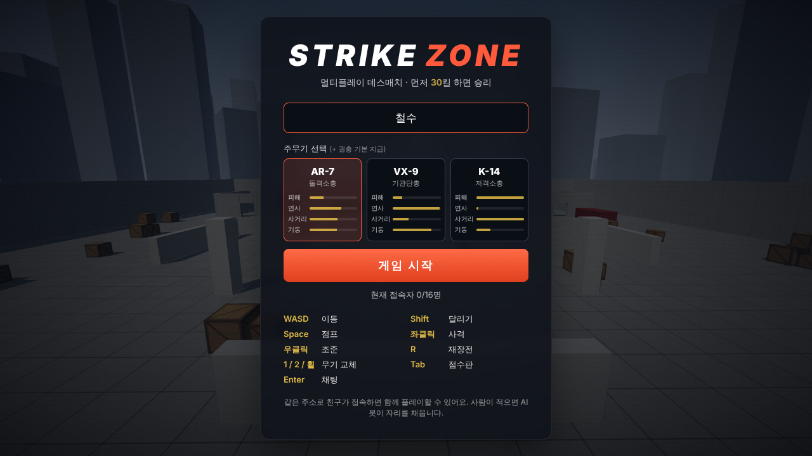

# STRIKE ZONE — 브라우저 멀티플레이 FPS

Three.js + WebSocket으로 만든 데스매치 FPS입니다. 설치 후 서버 하나만 켜면 같은 주소로 접속한 사람끼리
바로 함께 플레이할 수 있고, 사람이 적으면 AI 봇이 자리를 채웁니다.




## 실행

```bash
cd fps
npm install
npm start          # http://localhost:3000
```

친구와 하려면 같은 네트워크에서 `http://<내 IP>:3000`으로 접속하거나, 서버를 Render / Railway / Fly.io 같은
곳에 올리면 됩니다(`PORT` 환경변수 사용).

| 환경변수 | 기본값 | 설명 |
|---|---|---|
| `PORT` | 3000 | 서버 포트 |
| `BOTS` | 6 | 사람이 이 수보다 적으면 봇으로 채움 (0이면 봇 없음) |
| `KILL_LIMIT` | 30 | 라운드 승리 킬 수 |

## 조작

WASD 이동 · Shift 달리기 · Space 점프 · 좌클릭 사격 · 우클릭 조준(저격총은 스코프) · R 재장전 ·
1/2/휠/Q 무기 교체 · Tab 점수판 · Enter 채팅 · Esc 일시정지(감도·음량·주무기 변경)

## 들어 있는 것

- **무기 4종**: AR-7 돌격소총, VX-9 기관단총, K-14 저격소총(스코프, 헤드 1방), P-22 권총(보조무기).
  무기마다 반동·탄퍼짐·연사·거리별 피해 감소·이동속도가 다르고 1인칭 모델과 사운드도 따로 있습니다.
- **서버 권위 판정**: 피해·탄약·연사 속도·재장전·무기 교체 시간은 서버가 판정하고, 순간이동은 되돌립니다.
  핑 + 보간 지연만큼 상대 위치를 되감아 판정하는 **랙 보상** 포함.
- **AI 봇**: A* 길찾기로 맵을 돌아다니고, 시야·반응 시간·에임 오차·스트레이프·점사가 있습니다.
  사람이 들어오면 자동으로 한 명씩 빠집니다.
- **연출**: 실시간 그림자, 절차적 텍스처, 총구 화염/조명, 탄도 궤적, 탄흔·피격 파티클, 무기 흔들림·반동·
  재장전/교체 애니메이션, 착지 흔들림, 3D 위치 사운드(발소리 포함), 피격 방향 표시, 체력 재생.
- **HUD**: 미니맵(사격한 적만 표시), 킬피드, 히트마커(헤드샷/킬 색상), 더블킬·연속처치 알림,
  사망 화면(누가·무슨 무기로·상대 남은 체력), 점수판, 채팅, 라운드 종료/재시작.

## 구조

```
fps/
  server.js            HTTP + WebSocket 서버, 게임 판정, 라운드 관리
  bots.js              AI 봇 (내비게이션 그리드 + A*)
  public/
    index.html, style.css
    game.js            클라이언트 (렌더링, 이동/충돌, 무기, HUD, 네트워크)
    shared/map.js      맵·무기·레이캐스트 — 서버와 클라이언트가 같이 씀
  test/bots.test.js    헤드리스 멀티플레이 테스트 (npm test)
```
