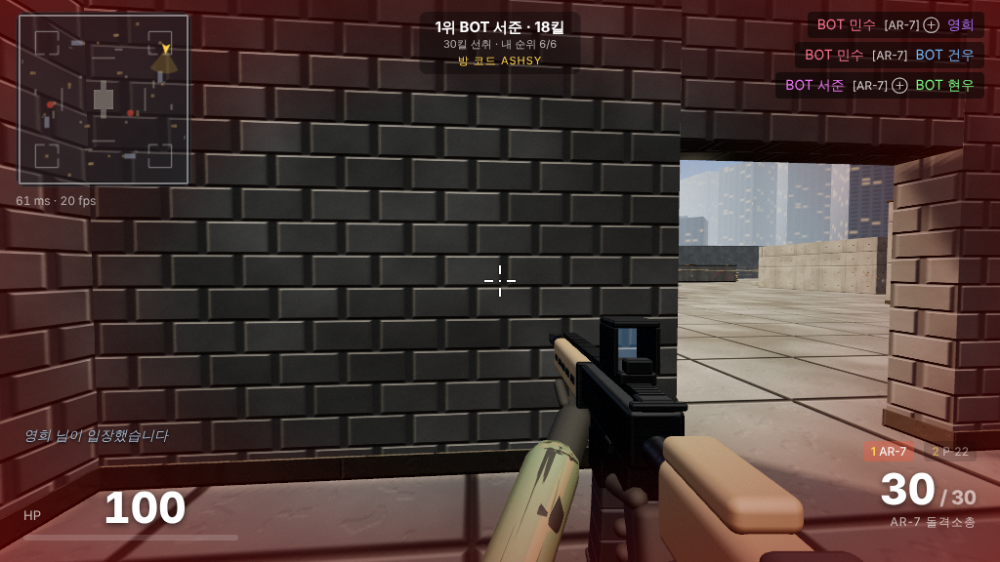
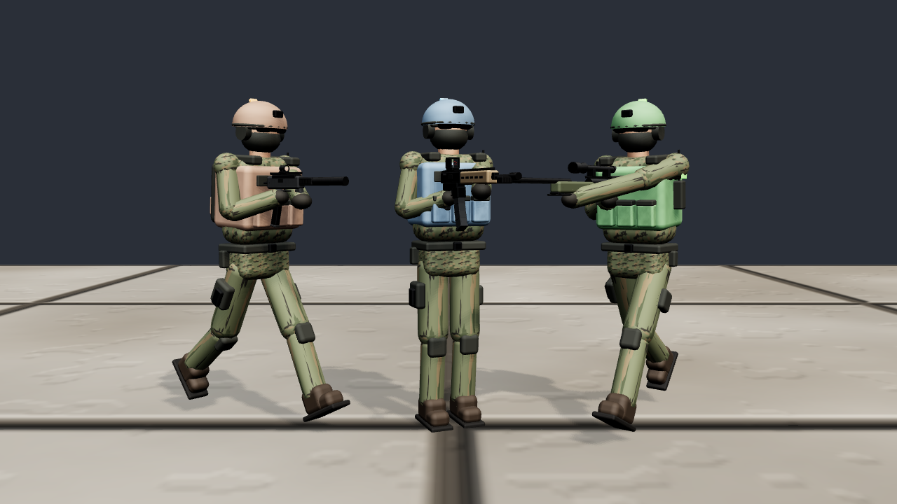
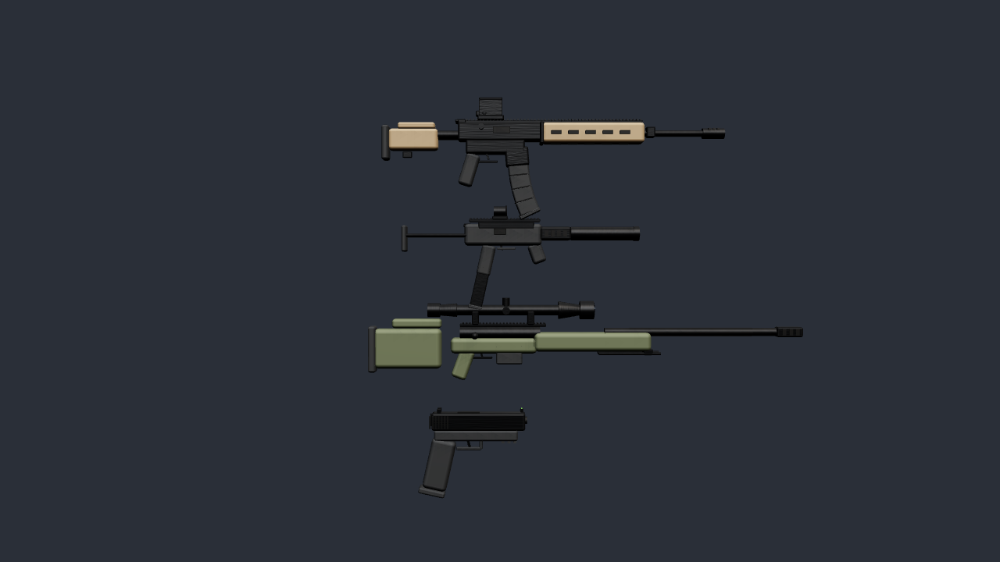

# STRIKE ZONE — 브라우저 멀티플레이 FPS

**설치할 것 없이 Node.js만 있으면 바로 실행**되는 멀티플레이 FPS입니다. `npm install`도 필요 없고,
three.js와 WebSocket 서버가 모두 이 폴더에 들어 있습니다. 방을 만들고 **방 코드**를 친구에게 보내면
같은 방에서 함께 플레이합니다.



| 캐릭터 | 무기 |
|---|---|
|  |  |

## 1. 실행 (1분)

1. **Node.js 설치** — <https://nodejs.org> 에서 LTS 버전 (한 번만)
2. 이 폴더에서 실행
   - **Windows**: `start-windows.bat` 더블클릭
   - **macOS**: `start-mac.command` 더블클릭 (처음엔 우클릭 → 열기)
   - **Linux / 터미널**: `node server.js`
3. 브라우저에서 `http://localhost:3000` 이 열리면 끝

서버 창에 친구가 접속할 주소가 표시됩니다:

```
  내 컴퓨터에서 접속:      http://localhost:3000
  같은 와이파이 친구 접속: http://192.168.0.12:3000
```

## 2. 친구와 같이 하기 (방 코드)

1. 서버를 켠 사람이 게임에서 **[방 만들기]** → 화면 위에 `방 코드 K7Q2M` 이 표시됨
2. 친구는 서버 주소로 접속해서 **방 코드 입력 → [코드로 참가]**
   - 또는 `Esc` 메뉴의 **[초대 링크 복사]** 로 받은 링크를 열면 코드가 자동 입력됨
3. **[빠른 시작]** 은 누구나 들어오는 공개 방, **방 만들기**는 코드를 아는 사람만 들어오는 방
4. 사람이 적으면 AI 봇이 자리를 채움 (방 만들 때 "AI 봇 채우기" 체크 해제하면 사람끼리만)

### 다른 동네(인터넷) 친구와 하려면

같은 와이파이가 아니면 서버 주소를 인터넷에 열어야 합니다. 셋 중 편한 방법 하나:

| 방법 | 하는 법 |
|---|---|
| **무료 터널 (가장 쉬움)** | 서버를 켠 채로 새 터미널에서 `npx localtunnel --port 3000` 또는 `cloudflared tunnel --url http://localhost:3000` → 나온 `https://…` 주소를 친구에게 |
| **무료 호스팅** | 이 폴더를 GitHub에 올리고 Render.com → New Web Service → Start Command `node server.js` (포트는 자동) |
| **공유기 포트포워딩** | 공유기 설정에서 TCP 3000 → 내 PC IP로 포워딩, 친구는 `http://<내 공인 IP>:3000` |

`https://` 주소에서도 그대로 동작합니다 (자동으로 `wss://` 사용).

## 조작

`WASD` 이동 · `Shift` 달리기 · `Space` 점프 · `좌클릭` 사격 · `우클릭` 조준(저격총은 스코프) · `R` 재장전 ·
`1`/`2`/`휠`/`Q` 무기 교체 · `Tab` 점수판 · `Enter` 채팅 · `Esc` 메뉴(방 코드·초대 링크·감도·음량·그래픽·주무기)

## 설정 (환경변수)

| 변수 | 기본값 | 설명 |
|---|---|---|
| `PORT` | 3000 | 서버 포트 (`PORT=3001 node server.js`) |
| `BOTS` | 6 | 방 인원이 이보다 적으면 봇으로 채움 (0 = 봇 없음) |
| `KILL_LIMIT` | 30 | 라운드 승리 킬 수 |

## 들어 있는 것

- **방 코드 시스템**: 방마다 독립된 경기(점수·라운드·봇). 빈 방은 자동 삭제. 최대 16명/방.
- **무기 4종**: AR-7 돌격소총(홀로사이트), VX-9 기관단총(소음기·리플렉스), K-14 저격소총(스코프·볼트액션),
  P-22 권총. 레일·M-LOK 홈·탄창·장전손잡이까지 모델링, 손가락이 그립을 감싸는 1인칭 팔, 탄피 배출.
- **캐릭터**: 관절(무릎·팔꿈치 IK) 있는 병사 — 위장복, 플레이트 캐리어+파우치, 헬멧+고글+청음기, 배낭,
  무릎보호대, 전투화. 플레이어별 장비 색상. 걷기/점프/사망 애니메이션.
- **그래픽**: 절차적 PBR 텍스처(노멀맵 — 콘크리트 블록, 보도블록, 골판지 컨테이너+녹, 나무 상자, 드럼통,
  모래주머니), 실시간 그림자, 구름 하늘, 창문 불빛 도시, 블룸·비네트·색보정 후처리, 탄흔·먼지·피 효과.
  `Esc` 메뉴에서 그래픽 품질 "낮음"으로 바꾸면 저사양 PC에서도 부드럽게 돌아갑니다.
- **서버 판정**: 피해·탄약·연사·재장전·무기교체를 서버가 확인, 순간이동 차단, 랙 보상.
- **AI 봇**: A* 길찾기, 시야·반응 시간·에임 오차·스트레이프·점사.
- **HUD**: 미니맵, 킬피드, 히트마커, 더블킬/연속처치, 사망 화면, 점수판, 채팅, 라운드제.

## 파일 구조

```
server.js          게임 서버 (방, 판정, 라운드) — 실행 파일
ws-lite.js         내장 WebSocket 서버 (외부 패키지 없음)
bots.js            AI 봇
public/
  index.html, style.css
  game.js          클라이언트 (입력, 이동, 무기, HUD, 네트워크)
  models.js        총기·팔·병사·소품 모델
  textures.js      절차적 텍스처 생성
  world.js         맵·조명·하늘·도시
  shared/map.js    맵·무기 데이터 (서버와 공유)
  vendor/          three.js (MIT, 동봉)
  preview.html     모델 미리보기 (?m=guns | soldier | ar | smg | sniper | pistol)
test/bots.test.js  자동 테스트 (node test/bots.test.js)
```
